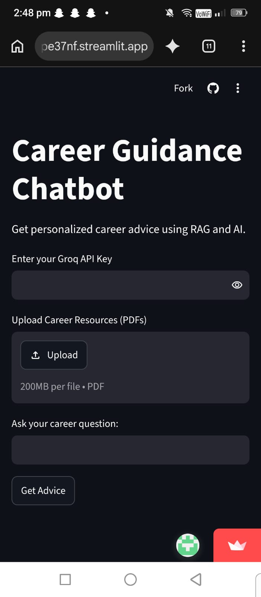

# Carrer_Guidance_Chatbot_app
AI-powered Carrer Guidance Chatbot Using Python
🚀 Live Demo

"Click Here to Open Career Guidance Chatbot" (https://carrerguidancechatbotapp-hap3zstknw8rmprfpe37nf.streamlit.app/)
Career Guidance Chatbot 🤖

An AI-powered Career Guidance Chatbot that helps students explore career opportunities and receive personalized career advice.

✨ Features

- Upload career-related PDF documents.
- Ask career-related questions.
- Get AI-powered career guidance.
- Receive personalized recommendations.

🛠️ Technologies Used

- Python
- Streamlit
- ChromaDB
- TF-IDF
- Groq API
- LangChain

📸 Project Screenshots

Screenshots of the application will be added here.

⚙️ Installation

1. Clone this repository.
2. Install the required dependencies.
3. Configure your API key securely.
4. Run the Streamlit application.

🎯 Project Objective

To help students make better career decisions using Artificial Intelligence and personalized recommendations.

👩‍💻 Developed By

Student Developer | CSE - Data Science
## 📸 Project Screenshots

🛠️ Technologies Used

Technology| Purpose
Python| Backend programming
Streamlit| Web application interface
ChromaDB| Vector database
TF-IDF| Text feature extraction
Groq API| AI-powered responses
LangChain| Language model integration
PyPDF2| PDF text extraction
Scikit-learn| Machine learning tools

✨ Key Features

1. PDF Upload: Upload career-related PDF documents.
2. AI Career Guidance: Ask questions and receive AI-generated career advice.
3. Personalized Recommendations: Get suggestions based on career interests and uploaded information.
4. Document Processing: Extract and process text from PDF files.
5. Semantic Search: Retrieve relevant information using ChromaDB and TF-IDF.
6. Interactive Interface: Simple and user-friendly Streamlit application.

## ⚙️ Installation and Setup

### 1. Clone the Repository

git clone YOUR_GITHUB_REPOSITORY_URL

### 2. Navigate to Project Folder

cd Career-Guidance-Chatbot

### 3. Install Dependencies

pip install -r requirements.txt

### 4. Configure API Key

Add your Groq API key securely using Streamlit Secrets.

### 5. Run the Application

streamlit run YOUR_PYTHON_FILE.py

## 📌 Requirements

- Python 3.10 or above
- Internet connection
- Groq API key

